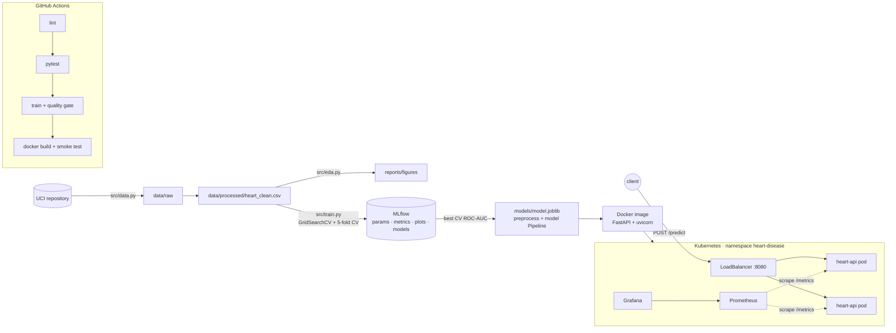

# Heart Disease Risk Prediction – End-to-End MLOps

MLOps (AIMLCZG523) Assignment 1. Predicts presence of heart disease from 13 clinical
features (UCI Heart Disease, Cleveland subset) and serves the model as a monitored,
containerised API on Kubernetes.

## Architecture



## Repository layout

| Path | Purpose |
|------|---------|
| `src/data.py` | download + clean dataset (`python -m src.data`) |
| `src/eda.py` | EDA figures → `reports/figures/` |
| `src/features.py` | `ColumnTransformer` preprocessing (impute, scale, one-hot) |
| `src/train.py` | tune + compare LogReg / RandomForest / GradientBoosting, MLflow logging, saves best model |
| `api/main.py` | FastAPI service: `/predict`, `/health`, `/info`, `/metrics` |
| `tests/` | pytest unit tests for data, pipeline and API |
| `notebooks/` | EDA and inference notebooks |
| `.github/workflows/ci.yml` | lint → test → train → docker build/smoke test |
| `Dockerfile`, `docker-compose.yml` | container + local monitoring stack |
| `k8s/` | Deployment, LoadBalancer Service, Prometheus, Grafana, `deploy.sh` |
| `monitoring/` | Prometheus config, Grafana datasource + dashboard |
| `screenshots/` | evidence for the report |

## Setup (clean machine)

```bash
python3 -m venv .venv && source .venv/bin/activate
pip install -r requirements.txt

python -m src.data      # 1. download + clean  -> data/processed/heart_clean.csv
python -m src.eda       # 2. EDA figures       -> reports/figures/
python -m src.train     # 3. train + MLflow    -> models/model.joblib, mlflow.db
pytest                  # 4. unit tests
ruff check src api tests

mlflow ui --backend-store-uri sqlite:///mlflow.db   # http://127.0.0.1:5000
```

## Run the API

**Locally**
```bash
uvicorn api.main:app --reload            # http://127.0.0.1:8000/docs
```

**Docker**
```bash
docker build -t heart-api:1.0 .
docker run --rm -p 8000:8000 heart-api:1.0
curl -X POST localhost:8000/predict -H 'content-type: application/json' -d @sample_request.json
```

Example response:
```json
{"model": "random_forest",
 "results": [{"prediction": 1, "label": "disease", "confidence": 0.9754, "probability_disease": 0.9754},
             {"prediction": 0, "label": "no_disease", "confidence": 0.93, "probability_disease": 0.07}]}
```

**Docker Compose with monitoring:** `docker compose up --build` starts the API (:8000),
Prometheus (:9090) and Grafana (:3000).

## Deploy to Kubernetes (Docker Desktop)

1. Docker Desktop → Settings → Kubernetes → *Enable Kubernetes* → Apply.
2. `kubectl config use-context docker-desktop`
3. `./k8s/deploy.sh`

| Service | URL |
|---------|-----|
| API (LoadBalancer) | http://localhost:8080/docs |
| Prometheus | http://localhost:9090 |
| Grafana | http://localhost:3000 → *Heart Disease API – Monitoring* |

Generate traffic for the dashboard: `./scripts/send_traffic.sh http://localhost:8080 300`

View request logs: `kubectl -n heart-disease logs -l app=heart-api -f`

## API

| Method | Path | Description |
|--------|------|-------------|
| POST | `/predict` | one patient object or a list → prediction, label, confidence |
| GET | `/health` | liveness / readiness |
| GET | `/info` | model name, hyper-parameters, metrics |
| GET | `/metrics` | Prometheus metrics |

Input fields: `age, sex, cp, trestbps, chol, fbs, restecg, thalach, exang, oldpeak, slope, ca, thal`
(`ca` and `thal` optional → imputed). Invalid values return HTTP 422.
